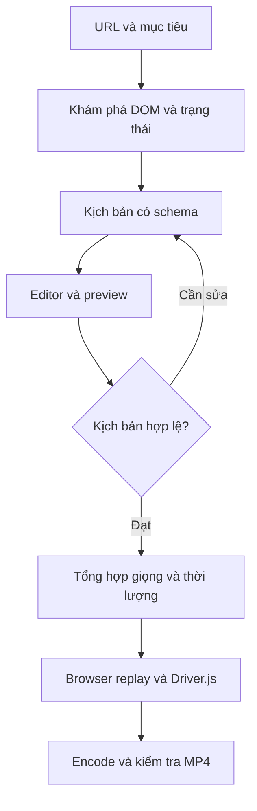

# Thiết kế sản phẩm đích

## Hành vi

Một URL đủ để làm video tổng quan. Để hướng dẫn tác vụ, giao diện hỏi thêm mục tiêu ngắn (ví dụ “chọn Premium và kiểm tra giỏ hàng, dừng trước thanh toán”). Ngôn ngữ mặc định VI, tỉ lệ 16:9. Người dùng sửa thứ tự, lời thoại, điểm focus, thời lượng và điểm dừng trước render.

CLI hiện có B ở mức một trang, C không dùng AI, preview D bằng browser và G/H không có giọng. Sơ đồ là sản phẩm đích, không phải danh sách tính năng đã hoàn thành.

## Các lớp

- Studio: React + Vite; URL/mục tiêu, step editor, preview, render progress, downloads. Local HTTP API chỉ bind loopback trong bản desktop. Electron là tùy chọn, chưa cần ngay.
- Planner: input DOM evidence + mục tiêu; output JSON theo schema, có selector gắn evidence. Nội dung website là dữ liệu không tin cậy, không phải chỉ dẫn hệ thống. Không cho LLM phát JavaScript tùy ý; không gọi LLM mỗi frame.
- Explorer: Playwright sandbox, lưu các trạng thái cần cho task; giới hạn domain, số bước, thời gian; có thao tác ghi thủ công khi site quá động. Nhận biết đăng nhập/CAPTCHA để dừng, không cố vượt.
- Validator: schema, unique locator, trạng thái kỳ vọng, dữ liệu mẫu, terminal stop. Preview cũng thực thi các click được duyệt: UI phải làm rõ điều đó.
- Renderer: manifest + asset audio bất biến; Driver.js focus; cursor easing; reset/inject lại sau navigate; log từng bước. Bản V1 dùng Playwright video. V2 thử webreel để tăng chất lượng chuyển động, không coi nó là AI planner.
- Audio: tổng hợp từng câu trước khi quay; duration thực tế từ ffprobe; hold = max(minHold, speechDuration + tail). Ghép audio theo timeline thực tế; lưu cùng boundary cho SRT/VTT. Web Speech phát trong browser không được mặc định coi là audio đã được ghi vào video.
- Compositor: FFmpeg H.264/yuv420p/AAC/faststart. Cắt đoạn chờ, intro/outro, optional zoom. Encode không được biến video giật thành mượt chỉ bằng tăng fps.
- Job store: local SQLite ở giai đoạn Studio, file asset theo job id. Khi nhiều worker: PostgreSQL + Redis/BullMQ và object storage; không cần thêm lúc CLI.

## Dữ liệu đích (chưa triển khai DB)

| Entity | Trường chính |
|---|---|
| Project | id, title, startUrl, goal, language, createdAt |
| PlanVersion | id, projectId, version, schemaVersion, planJson, evidenceHash, approvedAt |
| Step | id, planVersionId, order, action, targetJson, expectedJson, narration, holdMs |
| Asset | id, projectId, type, relativePath, sha256, durationMs |
| RenderJob | id, planVersionId, state, progress, currentStep, error, createdAt, finishedAt |
| RenderArtifact | id, jobId, type, relativePath, codec, width, height, durationMs |

Manifest v1 trong code là nguồn sự thật của CLI. Editor phải tạo version mới khi sửa; job luôn ghim một version. Chỉ resume phần tổng hợp audio/encode an toàn; replay website sau lỗi cần phục hồi trạng thái, không tự nhảy lại vào thao tác có tác động.

## API dự kiến (chưa triển khai)

| Method | Route | Kết quả |
|---|---|---|
| POST | /api/projects | URL, mục tiêu → projectId |
| POST | /api/projects/:id/discover | discoveryJobId |
| GET | /api/projects/:id/plans/latest | Plan + evidence |
| PUT | /api/projects/:id/plans | Plan version mới; optimistic concurrency |
| POST | /api/plans/:id/validate | Lỗi schema/locator |
| POST | /api/plans/:id/preview | Preview job |
| POST | /api/plans/:id/render | Render job, idempotency key |
| GET | /api/jobs/:id/events | SSE tiến độ |
| POST | /api/jobs/:id/cancel | Hủy tại checkpoint an toàn |
| GET | /api/jobs/:id/artifacts | MP4, subtitle, report |

## Hostinger và triển khai

Không hardcode giá hoặc selector từ trí nhớ. Tạo template từ DOM hiện hành, có evidence từng bước: landing → bảng gói → chọn gói → kiểm tra giỏ → stop trước thanh toán. Bước tài khoản chỉ dùng trạng thái demo/đã che dữ liệu; không cho video chứa mật khẩu/thẻ. Với site cấm overlay/CSP, báo cần adapter/recording thủ công, không hứa chạy mọi website.

MacBook M3 16 GB phù hợp để bắt đầu với 1 Chromium worker, 720p hoặc 1080p và FFmpeg local; chưa có benchmark trên máy người dùng. Giới hạn concurrency = 1 trước, đo RSS/CPU/thời gian render rồi tăng. Chưa cần GPU local hay Docker. Cloud multi-user phải chặn private/metadata IP qua egress policy (kể cả redirect/DNS rebinding/subresource), cách ly browser và credentials, có auth/rate limits/retention trước khi mở URL tùy ý.
